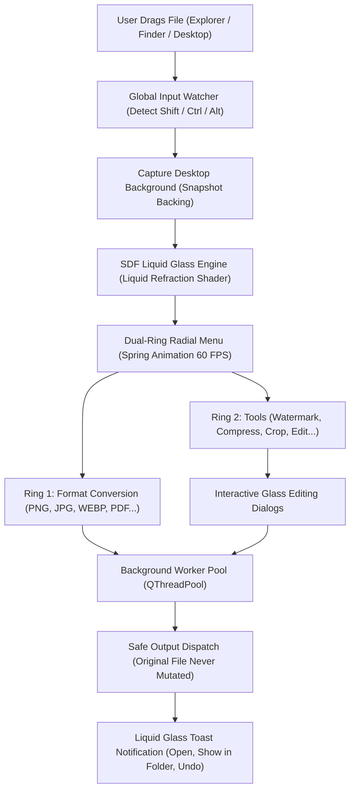

<div align="center">

<p align="center">
  
</p>

# Convertfy — Rapid File Converter & Editor

<p align="center">
  <a href="README.tr.md">🇹🇷 Türkçe</a> • <b>🇺🇸 English</b>
</p>

<p align="center">
  <strong>Shift+Drag-triggered, Liquid Glassmorphism UI, 100% private and secure file converter for Windows, macOS, and Linux.</strong><br>
  <em>Drag any file, press Shift, and instantly convert formats, compress, and edit within seconds using the liquid glass radial menu blooming directly under your cursor.</em>
</p>

<p align="center">
  <a href="LICENSE"></a>
  <a href="https://github.com/omerfys/Convertfy/stargazers"></a>
  <a href="https://www.python.org/"></a>
  <a href="https://wiki.qt.io/Qt_for_Python"></a>
  
  
  
</p>

<br>

> **Convertfy** is a modern, open-source desktop application that liberates the file conversion and editing experience from tedious web tools and clunky utility software. The moment you press **Shift** while dragging a file in File Explorer or Finder, a real-time liquid glass radial menu blooms, capturing and refracting the desktop behind it. The original file is never touched, outputs are saved side-by-side, and full undo support is provided.

[Quick Start](#quick-start--installation) • [Highlights](#highlights) • [Visual Showcase](#screenshots--visual-showcase) • [Formats & Tools](#supported-formats--capabilities) • [Architecture](#architecture--inner-workings) • [License](#license--contributing)

<br>

<div align="center">
  
  <p align="center"><em>Liquid glass radial menu powered by real-time optical refraction, chromatic dispersion, and spring physics</em></p>
</div>

---

</div>

## Table of Contents

- [Project Vision](#project-vision)
- [Highlights](#highlights)
- [Screenshots & Visual Showcase](#screenshots--visual-showcase)
- [Supported Formats & Capabilities](#supported-formats--capabilities)
- [Architecture & Inner Workings](#architecture--inner-workings)
- [Unique Features: Watermark & Dynamic Glass Themes](#unique-features)
- [Strict Safety & Original File Guarantee](#strict-safety--original-file-guarantee)
- [Quick Start & Installation](#quick-start--installation)
- [Compiling Binaries / Installers with PyInstaller](#compiling-with-pyinstaller)
- [Frequently Asked Questions (FAQ)](#frequently-asked-questions-faq)
- [License & Contributing](#license--contributing)

---

## Project Vision

Online web-based file converters upload your sensitive files to third-party servers, posing privacy risks and enforcing per-operation queue limits. Traditional desktop software clutters workflows with cumbersome multi-step dialogs and bloated interfaces.

**Convertfy** turns file processing into an instant reflex:
1. **Zero Interface Clutter:** No windows to hunt down. Start dragging any file, press **Shift**, and the menu is ready directly under your cursor.
2. **Liquid Glassmorphism Physics:** Upon opening, the menu snapshots the background desktop; a Signed Distance Field (SDF) engine bends light along curved glass edges, dispersing red, green, and blue wavelengths across distinct angles for a photorealistic iridescent rim glow.
3. **Dual-Ring Architecture:** Effortlessly toggle between **Convert** and **Tools** rings in milliseconds with a single tap of the Shift key.
4. **Non-Destructive Operations:** Your original files are never altered or overwritten; generated outputs are saved alongside the source or into a custom output folder of your choice.

---

## Highlights

- **Instant Radial Trigger:**
  - Cursor-centric activation whenever `Shift` (or optionally `Ctrl`, `Alt`) is pressed while dragging a file.
  - Safe, hook-free native input monitoring leveraging Windows API (`GetAsyncKeyState`), macOS (`NSEvent`), and Linux X11 integration.
- **4 Dynamic Glass Themes:**
  - **Cyber Neon:** Electric cyan, oceanic blue, and neon purple.
  - **Aurora Violet:** Cosmic purple, fuchsia pink, and indigo.
  - **Emerald Frost:** Crisp mint green, emerald, and sea tones.
  - **Sunset Prism:** Warm sunset coral, dusty rose, and lavender.
- **Bespoke Glass Window Architecture:**
  - Clean Convertfy brand badge, centered elegant headers, and sleek glass divider lines (`glassDivider`) across all tool dialogs.
  - Intuitive **Settings Panel** featuring a layered 4-card glass layout.
- **Advanced Watermark & Stamp Suite:**
  - Stamp images on the fly with presets such as `CONFIDENTIAL`, `DRAFT`, `COPYRIGHT ©`, or custom text.
  - Real-time live preview, opacity, rotation angle, tiled pattern mode, and 5 distinct glass accent palettes.
- **Interactive Liquid Toast Notifications:**
  - Fluid card toasts gliding in the bottom-right corner; size difference summary (`2.4 MB → 610 KB · 75% smaller`), `Open`, `Show in Folder`, and one-click `Undo` buttons.
  - **Sub-Millisecond IPC Handshake:**
  - If the application is already running in the background, drag-and-drop or right-click events do not launch a redundant process; files are immediately passed to the active instance via OS named pipes.

---

## Screenshots & Visual Showcase

### 1. Watermark & Stamp Suite
<div align="center">
  
  <p align="center"><em>Quick preset stamp chips, opacity and angle sliders, tile mode, and real-time glass preview</em></p>
</div>

---

### 2. Segmented Glass Cards Settings Panel
<div align="center">
  
  <p align="center"><em>4-tier glass card architecture: Dynamic theme selector, trigger configuration, quality profiles, and system integrations</em></p>
</div>

---

### 3. Precision Crop & Aspect Ratio Editor
<div align="center">
  
  <p align="center"><em>Freeform or locked aspect ratios (1:1, 16:9, 4:3), rotation controls, and live pixel dimension indicators</em></p>
</div>

---

## Supported Formats & Capabilities

| Category | Convertible Formats | Built-in Liquid Glass Tools |
|---|---|---|
| **Images**<br>`JPG, PNG, WEBP, HEIC, AVIF, TIFF, BMP, GIF, ICO` | To any image format or **a single merged PDF** document | **Watermark** (Custom watermark / stamp) · **Compress** (Smart compression by target size) · **Resize** (Pixel / percentage scaling) · **Crop** (Proportional cropping) · **Edit** (Auto-enhance, brightness, contrast, black & white) · **Annotate** (Arrows, boxes, numbered steps, text) · **Redact** (Privacy blur/censorship) · **Add BG** (Gradient background framing) · **Metadata** (EXIF & GPS strip) |
| **PDF Documents**<br>`PDF` | Per-page `JPG` or `PNG`, `DOCX`, `TXT` | **Compress** (Reduce PDF file size) · **Split** (Extract pages) · **Rotate** (Page orientation) · **Merge** (Combine multiple PDFs) · **Protect** (AES-256 encryption) · **Extract Images** (Dump embedded assets) · **Metadata** |
| **Word Documents**<br>`DOCX` | `PDF` (Built-in or Word engine), `TXT` | Rapid document export while preserving layout |
| **Text Files**<br>`TXT, MD, CSV, LOG, JSON...` | `PDF`, `DOCX` | Structured, styled document generation |

---

## Architecture & Inner Workings



---

## Unique Features

### Watermark & Stamp Suite
- **One-Click Quick Stamp Chips:** Instant stamps for enterprise documents or drafts (`CONFIDENTIAL`, `DRAFT`, `DO NOT COPY`, `SAMPLE`, `COPYRIGHT ©`).
- **Advanced Tiled Pattern:** Repeating diagonal watermark layout across the entire canvas for maximum copyright defense.
- **Smart Font Scaling:** Text typography automatically scales to the optimal proportion whether processing a 4K image or a miniature icon.

### Dynamic Glass Engine
- Changing themes in settings instantaneously updates all active dialogs, radial menu rim highlights, and toast cards in real time according to the selected color palette.

---

## Strict Safety & Original File Guarantee

1. **Original Files are Untouchable:** Every generated output is written side-by-side (e.g. `image (1).png`, `document Watermarked.pdf`) or saved directly to a dedicated `Convertfy` directory.
2. **One-Click Undo:** Accidental conversions can be rolled back immediately by clicking the `Undo` button in the liquid toast notification, moving the generated output safely to the OS Recycle Bin.
3. **100% Offline & Local Processing:** No file is ever transmitted over the network; all Pillow, PyMuPDF, and lxml operations run entirely on your local CPU and RAM.

---

## Quick Start & Installation

### Requirements
- **Operating System:** Windows 10/11, macOS 11+, or Linux (X11)
- **Python:** 3.10 or newer

### 1. Clone the Repository
```bash
git clone https://github.com/omerfys/Convertfy.git
cd Convertfy
```

### 2. Create and Activate a Virtual Environment
```bash
# Create virtual environment
python -m venv .venv

# Windows (PowerShell / CMD)
.venv\Scripts\activate

# macOS / Linux
source .venv/bin/activate
```

### 3. Install Dependencies
```bash
pip install -r requirements.txt
```

### 4. Launch Convertfy
```bash
python run.py
```
*(In File Explorer, drag any file and press the `Shift` key; the radial glass menu will blossom immediately.)*

---

## Compiling with PyInstaller

To bundle the application as a standalone desktop binary without requiring Python:

```bash
# Directory-based build (For installers and distribution)
pyinstaller Convertfy.spec --noconfirm

# Single-file standalone (.exe) build
$env:ONEFILE="1"; pyinstaller Convertfy.spec --noconfirm
```
The compiled binary will be placed directly in `dist/Convertfy.exe`.

### Running Unit Tests
```bash
pytest
```
*(Includes 22 unit tests with comprehensive self-test verification.)*

---

## Frequently Asked Questions (FAQ)

**Q: The radial menu does not appear when I drag a file. What should I check?**  
*A: The menu triggers specifically when holding down the left mouse button to drag a file and tapping the `Shift` key. You can also double-click the Convertfy system tray icon to select a file manually.*

**Q: Does it run on Linux distributions using Wayland?**  
*A: Wayland restricts global keyboard and mouse event monitoring for security reasons. An X11 session (XFCE, Cinnamon, MATE, or Ubuntu on Xorg) is recommended. On Wayland, the Right-Click → "Open with Convertfy" workflow functions smoothly.*

**Q: Are my files uploaded to any cloud or remote server?**  
*A: Absolutely not. Convertfy is a 100% offline and locally executed tool.*

---

## License & Contributing

This project is licensed under the [MIT License](LICENSE).  
Copyright (c) 2026 **omerfys** (Convertfy contributors).
