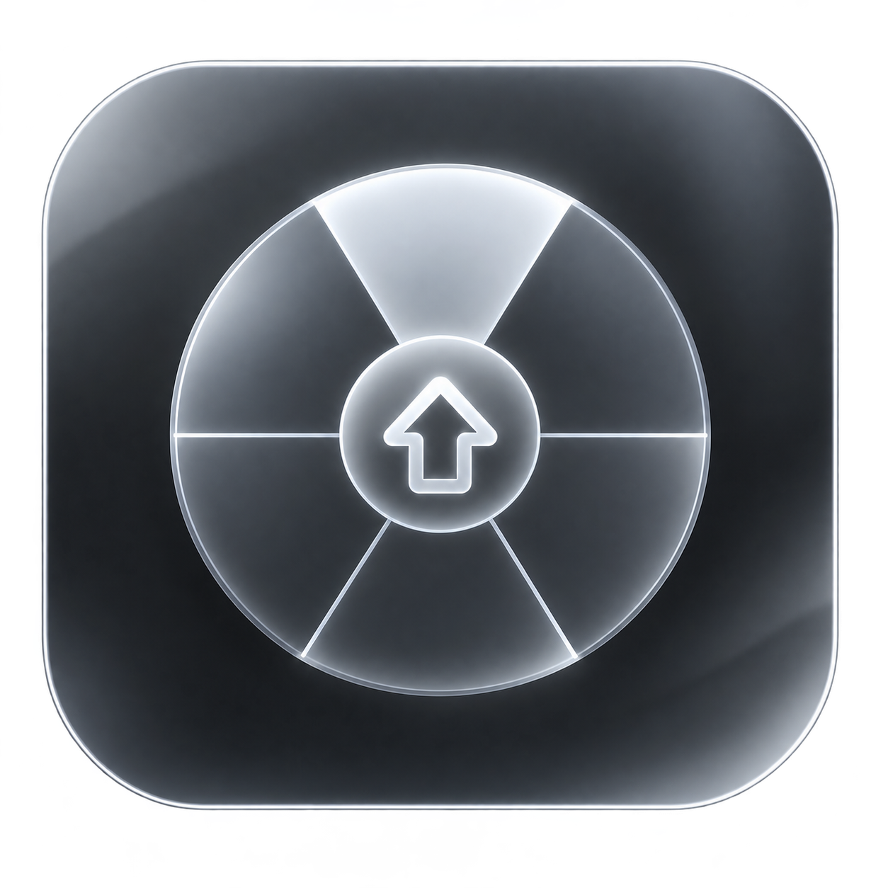
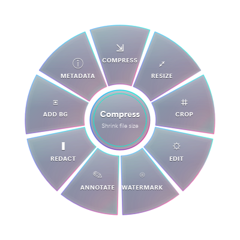
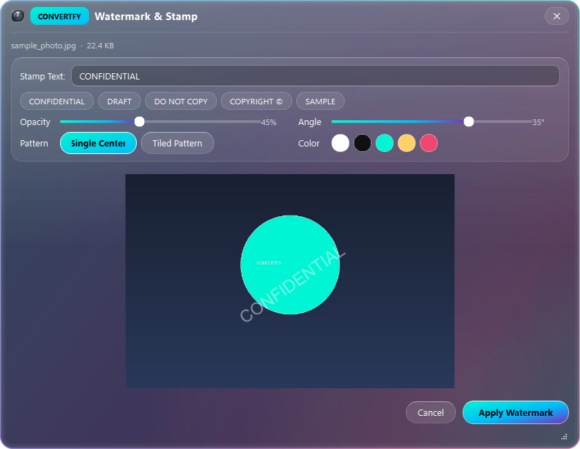
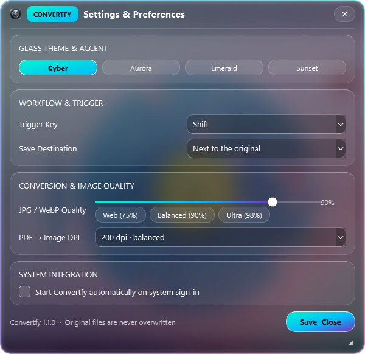
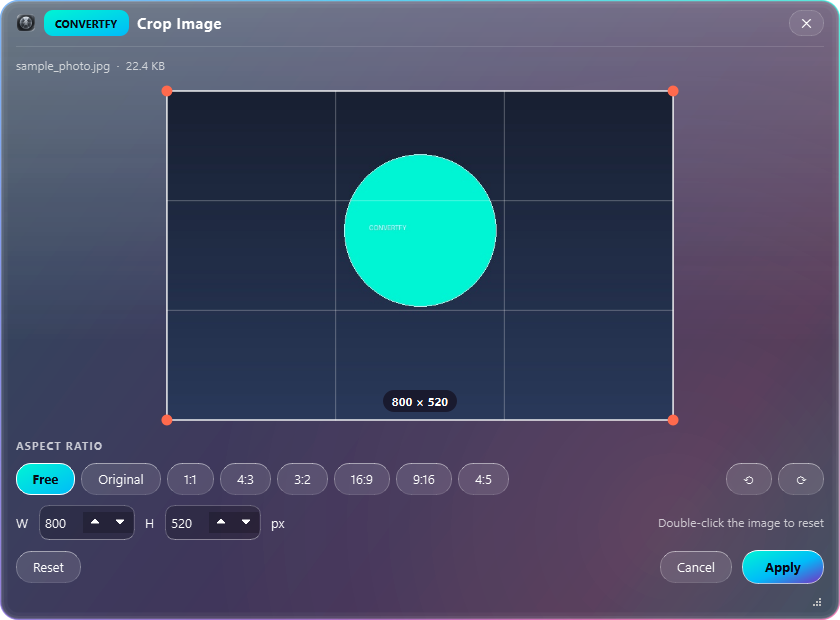
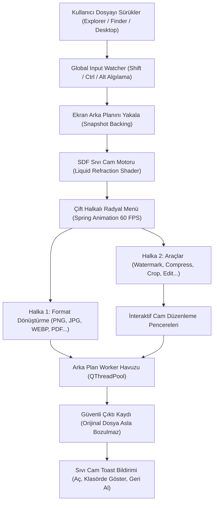

<div align="center">

<p align="center">
  
</p>

# Convertfy — Hızlı Dosya Dönüştürücü & Düzenleyici

<p align="center">
  <b>🇹🇷 Türkçe</b> • <a href="README.md">🇺🇸 English</a>
</p>

<p align="center">
  <strong>Windows, macOS ve Linux için Shift+Sürükle tetiklemeli, Liquid Glassmorphism arayüzlü ve %100 güvenli dosya dönüştürücü.</strong><br>
  <em>Herhangi bir dosyayı sürükleyin, Shift'e basın; imlecinizin altında açılan sıvı cam menüyle formatları saniyeler içinde dönüştürün, sıkıştırın ve düzenleyin.</em>
</p>

<p align="center">
  <a href="LICENSE"></a>
  <a href="https://github.com/omerfys/Convertfy/stargazers"></a>
  <a href="https://www.python.org/"></a>
  <a href="https://wiki.qt.io/Qt_for_Python"></a>
  
  
  
</p>

<br>

> **Convertfy**, masaüstünde dosya dönüştürme ve düzenleme deneyimini sıkıcı web araçlarından ve hantal programlardan kurtaran modern, açık kaynaklı bir masaüstü uygulamasıdır. Dosya Gezgini veya Finder'da bir dosyayı taşırken **Shift** tuşuna bastığınız an, masaüstünü kırarak arkasını yansıtan gerçek zamanlı bir sıvı cam radyal menü açılır. Orijinal dosyaya asla dokunulmaz, sonuç hemen yanına kaydedilir ve geri alma desteği sunulur.

[Hızlı Başlangıç](#hızlı-başlangıç--kurulum) • [Özellikler](#özellikler-highlights) • [Görsel Vitrin](#ekran-görüntüleri--görsel-vitrin) • [Formatlar & Araçlar](#desteklenen-formatlar--yetenekler) • [Mimari](#mimari--çalışma-prensibi) • [English Overview](#english-overview)

<br>

<div align="center">
  
  <p align="center"><em>Gerçek zamanlı optik kırılma (refraction), kromatik saçılma ve yay fiziğiyle çalışan sıvı cam radyal menü</em></p>
</div>

---

</div>

## İçindekiler (Table of Contents)

- [Proje Vizyonu](#proje-vizyonu)
- [Özellikler (Highlights)](#özellikler-highlights)
- [Ekran Görüntüleri & Görsel Vitrin](#ekran-görüntüleri--görsel-vitrin)
- [Desteklenen Formatlar & Yetenekler](#desteklenen-formatlar--yetenekler)
- [Mimari & Çalışma Prensibi](#mimari--çalışma-prensibi)
- [Özgün Özellikler: Filigran & Canlı Cam Temaları](#özgün-özellikler)
- [Kesin Güvenlik & Orijinal Dosya Garantisi](#kesin-güvenlik--orijinal-dosya-garantisi)
- [Hızlı Başlangıç & Kurulum](#hızlı-başlangıç--kurulum)
- [PyInstaller ile Binary / Installer Derleme](#pyinstaller-ile-derleme)
- [Sıkça Sorulan Sorular (FAQ)](#sıkça-sorulan-sorular-faq)
- [English Overview](#english-overview)
- [Lisans & Katkıda Bulunma](#lisans--katkıda-bulunma)

---

## Proje Vizyonu

İnternetteki çevrimiçi dosya dönüştürücüler dosyalarınızı yabancı sunuculara yükler, gizlilik riski taşır ve işlem başına süre kısıtları koyar. Geleneksel masaüstü yazılımları ise çok sayıda menü ve karmaşık pencerelerle iş akışınızı yavaşlatır.

**Convertfy**, dosya işlemeyi refleks haline getirir:
1. **Sıfır Arayüz Kalabalığı:** Pencere aramanıza gerek yok. Dosyayı sürüklemeye başlayıp **Shift** tuşuna bastığınız an menü imlecinizin altında hazır olur.
2. **Sıvı Cam (Liquid Glassmorphism) Fiziği:** Menü açıldığı anda masaüstünün anlık görüntüsünü alır; Signed Distance Field (SDF) motoruyla camın kavisli kenarlarında ışığı büker, kırmızı-yeşil-mavi bileşenleri farklı açılarla kırarak gerçekçi gökkuşağı parıltısı oluşturur.
3. **Çift Halka Mimarisi:** Shift tuşuna tek bir dokunuşla **Dönüştür (Convert)** ve **Araçlar (Tools)** halkaları arasında milisaniyeler içinde geçiş yapabilirsiniz.
4. **Tahribatsız İşlem:** Orijinal dosyalarınız asla silinmez veya üzerine yazılmaz; yeni dosya orijinalin yanında veya seçtiğiniz özel klasörde üretilir.

---

## Özellikler (Highlights)

- **Anında Radyal Tetikleyici:**
  - Dosyayı sürüklerken `Shift` (veya tercihinize göre `Ctrl`, `Alt`) tuşuna basıldığında doğrudan imleç merkezli açılış.
  - Windows API (`GetAsyncKeyState`), macOS (`NSEvent`) ve Linux X11 entegrasyonuyla sistem kancası olmadan güvenli girdi dinleme.
- **4 Farklı Canlı Cam Teması (Glass Themes):**
  - **Cyber Neon:** Elektrik camgöbeği, okyanus mavisi ve neon mor.
  - **Aurora Violet:** Kozmik mor, fuşya pembesi ve çivit mavisi.
  - **Emerald Frost:** Taze nane yeşili, zümrüt ve okyanus tonları.
  - **Sunset Prism:** Sıcak gün batımı mercanı, gül kurusu ve lavanta.
- **Bespoke Cam Pencere Mimarisi:**
  - Tüm araç pencerelerinde Convertfy marka rozeti, ortalanmış şık başlık ve cam ayırıcı çizgi (`glassDivider`).
  - 4 katmanlı cam kart düzenine sahip sezgisel **Ayarlar Paneli**.
- **Gelişmiş Filigran & Damga Aracı (Watermark & Stamp):**
  - Görsellere anında `CONFIDENTIAL`, `DRAFT`, `COPYRIGHT ©` veya özel metin basabilme.
  - Canlı önizleme, opaklık, döndürme açısı, döşeme (tiled) deseni ve 5 farklı cam renk paleti.
- **İnteraktif Cam Bildirim Kartları (Liquid Toasts):**
  - Sağ altta açılan akıcı kartlar; boyut farkı özeti (`2.4 MB → 610 KB · %75 daha küçük`), `Aç`, `Klasörde Göster` ve tek tıkla `Geri Al (Undo)` butonları.
- **Milisaniyelik IPC El Sıkışması:**
  - Uygulama arka planda zaten çalışıyorsa, sağ tık menüsünden veya dosyayı sürükleyip bırakırken yeni süreç açmaz; işletim sistemi borusu (named pipe) üzerinden çalışan kopyaya anında dosya aktarır.

---

## Ekran Görüntüleri & Görsel Vitrin

### 1. Watermark & Stamp (Filigran & Damga Aracı)
<div align="center">
  
  <p align="center"><em>Hazır damga çipleri, opaklık/açı sürgüleri, desen modu ve canlı cam önizleme ekranı</em></p>
</div>

---

### 2. Segmented Glass Cards Ayarlar Paneli
<div align="center">
  
  <p align="center"><em>4 katmanlı cam kart yapısı: Canlı tema seçici, tetikleyici ayarları, kalite profilleri ve sistem entegrasyonu</em></p>
</div>

---

### 3. Hassas Kırpma & Oran Düzenleyici (Crop Editor)
<div align="center">
  
  <p align="center"><em>Serbest veya sabit en-boy oranları (1:1, 16:9, 4:3), döndürme ve piksel boyut göstergesi</em></p>
</div>

---

## Desteklenen Formatlar & Yetenekler

| Kategori | Çevrilebilen Formatlar | Dahili Sıvı Cam Araçları |
|---|---|---|
| **Görseller**<br>`JPG, PNG, WEBP, HEIC, AVIF, TIFF, BMP, GIF, ICO` | Herhangi bir görsel formatına veya **tek bir birleşik PDF** belgesine | **Watermark** (Özel filigran / damga) · **Compress** (Hedef boyuta göre akıllı sıkıştırma) · **Resize** (Piksel / yüzde ölçekleme) · **Crop** (Oranlı kırpma) · **Edit** (Otomatik iyileştirme, ışık, kontrast, siyah-beyaz) · **Annotate** (Oklar, kutular, adımlar, metin) · **Redact** (Sansürleme) · **Add BG** (Gradyan arka plan ekleme) · **Metadata** (EXIF & GPS temizleme) |
| **PDF Belgeleri**<br>`PDF` | Sayfa başına `JPG` veya `PNG`, `DOCX`, `TXT` | **Compress** (PDF boyutunu küçültme) · **Split** (Sayfaları ayırma) · **Rotate** (Döndürme) · **Merge** (Birden fazla PDF'i birleştirme) · **Protect** (AES-256 şifreleme) · **Extract Images** (Gömülü görselleri çıkarma) · **Metadata** |
| **Word Belgeleri**<br>`DOCX` | `PDF` (Dahili veya Word motoru ile), `TXT` | Belge düzenini koruyarak hızlı dışa aktarma |
| **Metin Dosyaları**<br>`TXT, MD, CSV, LOG, JSON...` | `PDF`, `DOCX` | Biçimlendirilmiş belge üretimi |

---

## Mimari & Çalışma Prensibi



---

## Özgün Özellikler

### Watermark & Stamp (Filigran Sistemi)
- **Tek Tıkla Hazır Çipler:** Şirket belgeleri veya taslaklar için tek dokunuşla hazır damgalar (`CONFIDENTIAL`, `DRAFT`, `DO NOT COPY`, `SAMPLE`, `COPYRIGHT ©`).
- **Gelişmiş Döşeme (Tiled Pattern):** Tüm görseli kaplayan tekrarlayan çapraz filigran deseniyle maksimum telif koruması.
- **Akıllı Yazı Tipi Ölçekleme:** Görsel 4K veya küçük bir ikon olsa bile yazı boyutu otomatik olarak en ideal oranda ölçeklenir.

### Dinamik Cam Temaları (Dynamic Glass Engine)
- Ayarlar menüsünden tema değiştirildiğinde tüm aktif pencereler, radyal menü parıltıları ve bildirim kartları gerçek zamanlı olarak yeni temanın renk paletine uyarlanır.

---

## Kesin Güvenlik & Orijinal Dosya Garantisi

1. **Orijinal Dosyaya Asla Dokunulmaz:** Yapılan her işlem `resim (1).png`, `belge Watermarked.pdf` şeklinde yan yana veya `Convertfy` klasörüne yazılır.
2. **Tek Tıkla Geri Alma (Undo):** Yanlışlıkla yapılan bir dönüştürme bildirim kartındaki `Geri Al` butonuna basılarak işletim sisteminin Geri Dönüşüm Kutusu'na taşınabilir.
3. **Çevrimdışı & Yerel İşleme:** Hiçbir dosya internete yüklenmez; tüm Pillow, PyMuPDF ve lxml işlemleri tamamen yerel işlemcinizde ve RAM'inizde yürütülür.

---

## Hızlı Başlangıç & Kurulum

### Gereksinimler
- **İşletim Sistemi:** Windows 10/11, macOS 11+ veya Linux (X11)
- **Python:** 3.10 veya daha yeni bir sürüm

### 1. Depoyu Klonlayın
```bash
git clone https://github.com/omerfys/Convertfy.git
cd Convertfy
```

### 2. Sanal Ortamı Oluşturun ve Etkinleştirin
```bash
# Sanal ortam oluşturma
python -m venv .venv

# Windows (PowerShell / CMD)
.venv\Scripts\activate

# macOS / Linux
source .venv/bin/activate
```

### 3. Bağımlılıkları Yükleyin
```bash
pip install -r requirements.txt
```

### 4. Convertfy'ı Başlatın
```bash
python run.py
```
*(Dosya Gezgini'nde herhangi bir dosyayı sürüklerken `Shift` tuşuna basın; radyal cam menü hemen açılacaktır.)*

---

## PyInstaller ile Derleme

Uygulamayı Python gerektirmeden bağımsız bir masaüstü uygulaması olarak derlemek için:

```bash
# Klasör tipi derleme (Installer / Dağıtım için)
pyinstaller Convertfy.spec --noconfirm

# Tek dosya taşınabilir (.exe) derleme
$env:ONEFILE="1"; pyinstaller Convertfy.spec --noconfirm
```
Çıktı dosyası doğrudan `dist/Convertfy.exe` konumunda oluşturulur.

### Birim Testlerini Çalıştırma
```bash
pytest
```
*(22 birim testi ve tam self-test doğrulaması içerir.)*

---

## Sıkça Sorulan Sorular (FAQ)

**S: Radyal menü bende açılmıyor, ne yapmalıyım?**  
*C: Menü sadece bir dosyayı farenin sol tuşuyla sürüklerken `Shift` tuşuna bastığınızda açılır. Ayrıca sistem tepsisindeki (tray) Convertfy ikonuna çift tıklayarak da dosya seçebilirsiniz.*

**S: Wayland kullanan Linux dağıtımlarında çalışır mı?**  
*C: Wayland global klavye/fare dinlemeyi güvenlik nedeniyle kısıtlar. Bu nedenle X11 oturumu (XFCE, Cinnamon, MATE veya Ubuntu on Xorg) önerilir. Wayland üzerinde sağ tık → Convertfy ile Aç özelliği sorunsuz çalışır.*

**S: Dosyalarım internete yükleniyor mu?**  
*C: Kesinlikle hayır. Convertfy %100 yerel ve çevrimdışı çalışan bir araçtır.*

---

## English Overview

**Convertfy** is a modern, open-source file converter and image editor featuring a **liquid-glass radial menu** for Windows, macOS, and Linux.

- **Gesture-Driven Workflow:** Start dragging any file and press **Shift** to bloom an interactive glass radial menu directly under your cursor.
- **Two Rings:** Toggle between **Convert** (PNG, JPG, WEBP, PDF, DOCX, etc.) and **Tools** (Watermark, Compress, Crop, Edit, Redact, Protect) instantly.
- **Liquid Glassmorphism:** Real-time screen refraction with chromatic dispersion, iridescent rim highlights, and 4 customizable glass themes (Cyber Neon, Aurora Violet, Emerald Frost, Sunset Prism).
- **Non-Destructive:** Source files are never modified or overwritten. Every action includes an undo action.
- **100% Offline & Private:** Powered locally by PySide6, Pillow, PyMuPDF, and python-docx.

---

## Lisans & Katkıda Bulunma

Bu proje [MIT Lisansı](LICENSE) altında lisanslanmıştır.  
Telif Hakkı (c) 2026 **omerfys** (Convertfy contributors).
